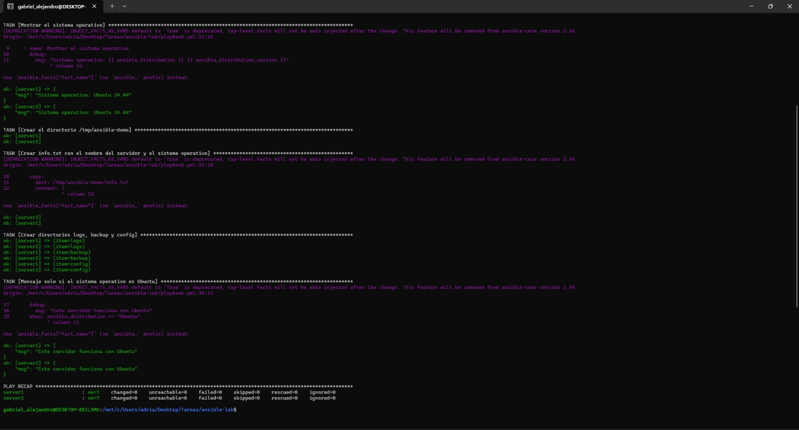
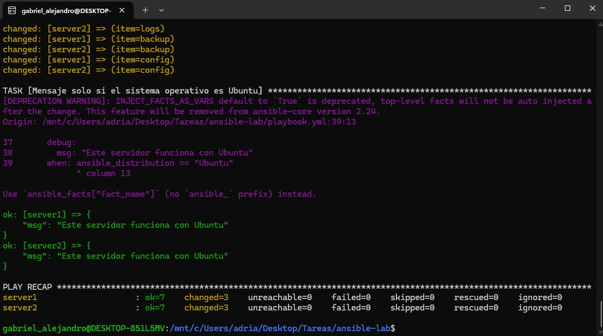

# Laboratorio Ansible con Docker

## Objetivo de la práctica
Crear un laboratorio con dos servidores Ubuntu usando Docker y administrarlos
con Ansible mediante un inventario y un playbook que automatiza tareas básicas
(mostrar información del host, crear directorios y archivos, usar loops y condicionales).

## Iniciar los contenedores
```bash
docker compose up -d
docker ps
```

Instalar Python en cada contenedor:
```bash
docker exec server1 bash -c "apt update && apt install -y python3"
docker exec server2 bash -c "apt update && apt install -y python3"
```

## Comprobar la conexión
```bash
ansible docker -i inventory.ini -m ping
```

## Ejecutar el playbook
```bash
ansible-playbook -i inventory.ini playbook.yml
```

## Capturas de la ejecución exitosa

### Captura 1


### Captura 2
